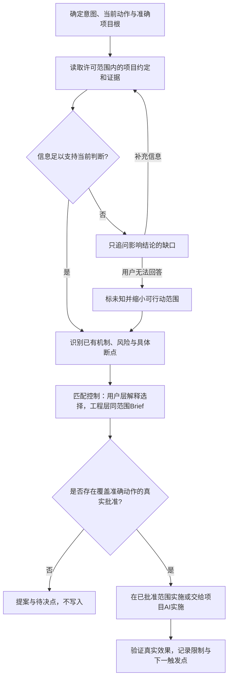

# 用户旅程、输入充分性与输出合同

本规格是v1必须实现的工作流，不是仅供参考的文字。

## 1. 总流程

用户不必知道模式名称。Skill先用一句话说明采用什么路径；解释性提问不能被自动升级为扫描磁盘或改项目。

## 2. 最低产品信息：缺什么、问谁、阻止什么

| 信息 | 优先来源 | 缺失后的处理 |
|---|---|---|
| 使用者与用户结果 | 用户、已有产品文档 | 可以说明选项，不能假定一个完整产品范围 |
| 本次希望执行的动作 | 当前请求与任务 | 意图不清先确认，不自动切到全项目审计 |
| 准确项目根与既有资产 | 工具只读核验、用户选择 | 无读取范围则不扫描；嵌套仓库不默认新建Git |
| 数据类别与副作用 | 用户说明、配置/代码元数据 | 未知时禁止真实删除/迁移/外部发送，可做只读或虚构原型 |
| 使用环境与暴露面 | 现有运行说明、用户 | 本机演示与公网服务分开判断 |
| 协作方式和写入者 | 任务系统、当前工具 | 不明时默认单一受控写者，不宣称并发安全 |
| 希望的自主程度和必须批准项 | 用户、有效项目规则 | 可生成草案，不能授予阶段执行权 |
| 验证与恢复条件 | 实际检查/备份证据 | 不以文件存在认定已可运行或已可恢复 |

先检索已有回答，再问。通常每轮最多三个高价值问题，这只是认知负担建议，不得为了凑数量遗漏危险动作的必要条件。用户不知道时提供选择、说明后果，保存未知和动作限制，不无限循环追问。

用户不需要先提供完整PRD，也不需要决定技术工具。涉及高影响行业或真实人身/财产风险时，明确本Skill不能给出安全认证，必要专家审查作为相关动作前提。

## 3. 充分性结果按动作输出

使用 `ready / conditional / blocked / not_assessed`，每项绑定 `for_action`、来源、限制、缺口及有效时点。`ready`仅表示已核查工程前提，不等于authorized。

示例：

- 只读盘点：ready，已确认根和读取边界。
- 虚构数据原型：conditional，需先批准候选目录和最小测试。
- 覆盖真实照片：blocked，恢复未证明，未获删除许可。

不得用平均分掩盖关键失败，不输出“项目已准备好”的无范围结论。

## 4. 四种模式：同一个引擎的四个入口

| 模式 | 最低输入 | 主要输出 | 默认不做 |
|---|---|---|---|
| kickoff | 用户结果、新旧情况、根/数据风险、本次动作 | 工程画像、当前启动线、首个里程碑、必要基建Brief | 自动建Git/安装依赖/初始化所有管理文件 |
| retrofit | 确认根、症状、可访问来源 | 1～3真实链路的断点、已有机制、最小修补与验证 | 全量历史搬迁、全面重写、伪造完成 |
| milestone-charter | 具体用户结果、起始版本、有效规则与可复用成果 | 阶段草案、任务依赖、A1/A2许可边界和验收 | 把草案当批准、直接跨任务施工 |
| continuity-check | 事件/当前动作、已登记来源、上次观察或任务身份 | 变化、过期、未知、复用点、下一动作与允许边界 | 每次扫描全仓、自动接收、替代产品测试 |

首次调用只有“帮我看看”时，先最小确认意图/范围。不能凭工作目录存在就推断允许全项目retrofit。

## 5. 生命周期场景矩阵

| 时点 | 路径 | 要重新判断的内容 | 不应重复的工作 |
|---|---|---|---|
| 仅有一个想法 | kickoff轻访谈 | 用户结果、数据、原型范围 | 不做仓库不存在却报已检查 |
| 新目录准备写代码 | kickoff | Git归属、可运行环境、基础检查 | 不复制完整平台模板 |
| 老项目第一次使用 | retrofit | 现状保护、权威来源、真实断点 | 不覆盖原AGENTS或任务系统 |
| 同项目再次调用 | 原模式或continuity | 新事实与旧画像是否冲突 | 不重问未变化的产品背景 |
| 新线程接手 | continuity | 根/分支/任务/授权/旧证据时点 | 不依赖旧聊天重述 |
| 普通一行文案修改 | 通常不调用深模式 | 必要最小变更范围 | 不启动全项目审计 |
| 一个任务准备收口 | continuity | 产物版本、验证结果、状态影响 | 不自动宣称Accepted |
| 开始新里程碑 | charter加就绪检查 | 目标、继承约束、任务依赖 | 不拿旧阶段许可无限续期 |
| 由本机转公网/开始真实数据 | retrofit定点 | 数据、权限、恢复、运行风险 | 不把旧低风险评级沿用 |
| 第二个执行者加入 | retrofit定点 | 写入归属、工作区、状态冲突 | 不让两个AI各写独立总账 |
| 发布前 | continuity加专项缺口 | 发布目标、兼容、恢复、必要验收 | 不把Git提交当部署完成 |
| Hook或来源变更/失效 | continuity或安装复查 | 覆盖、信任、路径、兼容 | 不虚报仍受强制保护 |
| Skill版本升级 | 兼容复查 | Schema、行为改变、项目绑定 | 不批量改所有已登记项目 |
| 停用/撤销权限 | 脱离登记 | 移除本Skill自己的触发与写权 | 不删业务账本和历史证据 |

四模式覆盖基建顾问的介入时机，不代替项目业务调度。采用后的日常执行归项目自身；仅在重要风险/规模/协作变化或机制失效时复评。可选接入不构成自动治理保证，详见 [脚本与接入](RUNTIME.md)。

## 6. 首次登记与再次恢复

项目用户同意后，建立或复用一个工程适配合同。内容只包含身份、产品画像、风险事实、原权威来源、采用控制、触发设置、未决问题与复查条件。

不得保存另一份完整任务状态、重复Acceptance、原始聊天或密钥。合同不是永久缓存：每次调用核对根身份、相关版本与变化。若项目移位、仓库重建或分支改变，不能只靠相同文件夹名认作同一现场。

无写入许可时，只在回复输出“建议登记内容”；不得宣称以后自动记住。再次调用若无持久记录，说明这一限制，而不是假装记得。

## 7. 决策透明度与实施状态

kickoff/retrofit 需要创建、补强或显著升级基建时，先给[用户层决策报告](../assets/USER_OUTPUTS.md)，再给同范围 Brief。新项目从开工条件和已有资产说起，不把空目录写成十项缺陷；已有项目先核能力与接线，不能靠某文件名缺失判定能力不存在。研究型项目按证据与工具实际判断，不能从目录大小推断它已有完整软件平台。

重要推荐必须解释条件、风险、不做的后果、最低机制、较轻/较重替代的取舍与升级触发。条件不足可给受限讨论方案，只追问会改变选择的未知；无需用户决定底层技术。只有实质可选方案才列选项，不为每项凑A/B/C。

第一次写真实项目先呈现选择并核批准；只读请求保持只读。已有准确授权覆盖当前版本、范围和动作时，不重复问同一许可、不等新报告批准才继续；展示简短差异与实际执行结果即可。拒绝/暂缓时保留影响、仍可做动作及复查条件，不把“我知道风险”当授权。危险动作可先暂停，其他合法动作继续。

下列是叙述语义，不新增账本或Schema状态枚举：

|语义|所需证据与边界|
|---|---|
|assessed 已诊断|限定根、来源、版本和未知；不表示方案已批准|
|proposed 建议中|选择与Brief已提出；未授权部分不实施|
|authorized 范围已批准|核对真实用户许可及准确动作；不能从草案自生成|
|implemented 已实施|项目Main实际改动；不是已经验证|
|verified_in_scope 限定验证|实际版本、动作和测试范围匹配；不是人类Accepted|
|partially_verified / blocked / unknown|分别说明已覆盖部分、受阻动作或证据不足；不可互相替代|

Assessment既有capabilities/readiness.authorization分别描述能力与执行许可；其余沿用项目原记录或回复表达。JSON Brief/Charter的status仍为proposal_only，作为设计草案不改为authorized；实际阶段授权另引用户来源，已核批准的Main可据此继续。输出中的“当前状态”指动作与记录层次，不能让草案常量造成重复审批。

用户层必须独立包含用户可理解的成功、失败/暂停、退出与恢复限制；这些不是只能放在工程Brief的技术细节。高风险控制逐项给可观察的验收结果，较轻方案改变范围须重新展示并核确认；普通低风险建议可合并为简短段落，不让报告阻塞已批准的小修。

交给实施者前核对：用户选的结果、推荐范围、允许写入/运行与工程层逐项对应。工程层可细化用户已理解的同一机制所需文件，但不能增加未展示的控制、真实数据、安装、外部费用、并行写者或部署。范围新增只使新增部分待批准。完成后回到同一建议说明实际变化、验证/未运行、原建议是否已满足和复查触发，不建第二套验收状态。

维护责任不等于本次写权。引用已有状态或知识入口不授予写入；入口未定位或当前只读时，向 Main 返回证据和待同步事项，不把状态落盘混入已允许范围，也不换文件绕过。入口明确且更新动作已有有效批准时，按原许可连续更新，不重复请示；核对任务表、验收步骤和 Brief 的每项写入都落在同一准确范围。

## 8. 实施Brief最低颗粒度

每项补强写：真实问题及来源；现有可复用机制；准确文件/工具/数据边界；拟做动作；运行副作用；验证方式；撤回办法；写入者；需要何种批准；后续由什么事件触发复查。

涉及现有能力的方案，先指出原调用行为（含正常、零结果或失败分支）、拟变更，以及结果由谁消费并如何呈现。没有必要时保持原接口；确需改变则说明理由、受影响调用及迁移/验证范围，不能因为已有测试没覆盖就当作兼容。成功检查应沿真实使用入口到可观察结果执行；底层返回值或异常消息本身不替代尚未接通的展示链。无现成入口时明确最小接线位置和准确许可，不让未知调用方在阶段外补完承诺。此要求按实际项目适用，不规定一律返回列表或禁止异常。

例如“建立Git”必须细化为核仓库归属、追踪/排除清单、敏感及大文件检查、准确本地操作与验证。不能只给“请使用版本管理”的句子。

持续开发、实验或接手频繁时，按 [E07](03_CONTROL_CATALOG.md#e07-知识决定和复用) 把必要知识安排融入原方案：保留什么、原来源在哪里、何时读取、谁在什么变化下维护、依据与适用条件、何时复查失效。用短段即可；已有机制足够则说明复用，不额外建设。验证应从入口实际定位当前决定、证据和未决项；只存在一份摘要不算接续已验证。
